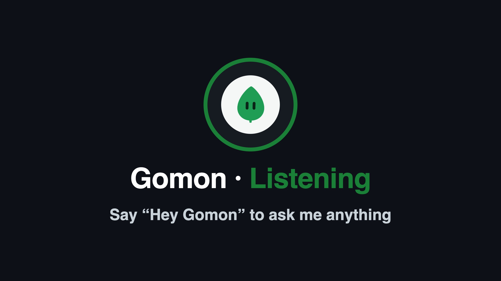
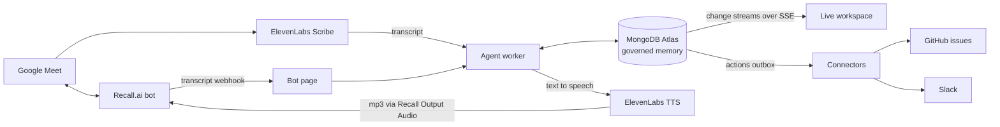

<p align="center">
  
</p>

<h1 align="center">GoMon</h1>

<p align="center"><strong>The design call agent with governed team memory.</strong></p>

<p align="center">
  
  
  
  
  
</p>

<p align="center">
  
</p>

Built at **Agents in Context Toronto** (MongoDB hackathon), Nov 14 2026, Lane 2: Memory You Can Govern.

GoMon joins an engineering design call as a voice teammate. It writes decisions, requirements, and risks to MongoDB Atlas as they are said, checks them against the team's canonical memory, and speaks when someone talks to it. If a new idea would break a locked decision or a customer requirement, it raises that once, at a pause. When the team agrees, it can lock the decision and file a GitHub issue and a Slack update through a policy checked, audited outbox.

All company context in this repo is synthetic (`seed/`). Full product spec: [`spec.md`](spec.md).

## What it does

- Sits in Google Meet as a voice participant (Recall.ai bot)
- Hears the room with the ElevenLabs Scribe speech to text API
- Speaks back with the ElevenLabs text to speech API, played into the call
- Writes structured memory (decisions, requirements, risks, constraints) to Atlas as the call happens
- Retrieves that memory so it changes the next answer, not just the prompt
- Locks a decision by consensus, with a veto window
- Files GitHub issues and Slack posts only after a policy check, with an audit trail
- Shows the live session, memory, and workflows in a web workspace

## How it works



The usual live path needs no public tunnel: open the local ears page, share the Meet tab with audio, and ElevenLabs Scribe transcribes the meeting and your mic. If you set `PUBLIC_BASE_URL` and run a stable tunnel, Recall can also send transcripts through `apps/bot-page`.

## Key features

**Governed memory.** Every memory has a `teamId` and `projectId`. Vector Search and Atlas Search always pre-filter on them, so one team's memory cannot leak into another's.

**Correct and forget.** "GoMon, correct that" writes a new version. "Forget that" tombstones the memory. Both run in a transaction with audit rows and leave retrieval at once. Call scratch expires by TTL unless it is locked.

**Proof that memory changed behavior.** The same proposal is flagged only when memory is on, and the reply cites the stored decision. A correction changes the next answer. Each reply records the memory ids it used.

**Audited actions.** A sent GitHub or Slack action has to pass a policy check first. The outbox is idempotent, and a reviewer can reconstruct what ran, why, and under whose authority.

**Voice with a floor.** GoMon stays quiet until someone says "Hey GoMon," with the conflict exception above. "Stop," or talking over it, cuts the clip. A short chime plays when it hears its name.

## Tech stack

- **Language:** TypeScript (Node 22+)
- **Memory and state:** MongoDB Atlas. Replica set transactions, JSON schema validators, TTL and unique indexes, change streams with stored resume tokens, Automated Embedding (`voyage-4`), Atlas Search and Vector Search fused with `$rankFusion`
- **Voice:** ElevenLabs API. Scribe realtime speech to text, and text to speech (`/v1/text-to-speech`) rendered as mp3
- **Meeting presence:** Recall.ai bot, with Output Audio into Google Meet
- **Apps:** `apps/worker` (agent worker), `apps/bot-page` (Recall bot and webhooks), `apps/web` (live workspace), `apps/connectors` (GitHub and Slack outbox)

## Quickstart

Copy `.env.example` to `.env` in the repo root and fill in your own keys. Never commit `.env`. The names you will most likely need are `MONGODB_URI`, `MONGODB_DB`, `ELEVENLABS_API_KEY`, `ELEVENLABS_VOICE_ID`, `RECALL_API_KEY`, `RECALL_REGION`, `LLM_PROVIDER`, `LLM_API_KEY`, `GITHUB_TOKEN`, `GITHUB_REPO`, `SLACK_BOT_TOKEN`, `SLACK_CHANNEL_ID`, `WORKER_TOKEN`, and `VOICE_OUT`.

```bash
cd apps/worker && npm install && npm run setup && npm run seed
VOICE_OUT=recall npm start
```

```bash
cd apps/web && npm install && npm run dev
```

```bash
cd apps/connectors && npm install && npm start
```

```bash
cd apps/worker && npm run join -- https://meet.google.com/<code> my-call "Design review"
```

Admit GoMon in Meet, then open `http://localhost:3001/ears?callId=my-call` in Chrome on the same laptop and share the Meet tab with audio. Watch the session at `http://localhost:3000/sessions/my-call`.

Without a meeting, replay the demo as typed utterances:

```bash
cd apps/worker && npm run say -- my-call --script
```

More detail lives in the app READMEs: [worker](apps/worker/README.md), [bot page](apps/bot-page/README.md), [web](apps/web/README.md), [connectors](apps/connectors/README.md).

## Demo

The live demo is a design review about EU data residency for a synthetic tenant, Globex.

1. Small talk is transcribed and stays silent.
2. "Hey GoMon, what did we discuss in our previous meetings about Globex?" recalls prior decisions and an open residency question from memory.
3. A proposal to keep Globex in a US region with an EU read replica is flagged, because it conflicts with a stored requirement that Globex data stay in the EU.
4. The team agrees on a separate EU Atlas cluster. GoMon locks the decision after a veto window, writes an ADR, and files the GitHub issue and Slack update.
5. "Hey GoMon, what ADRs do we have on data residency?" finds the new record in artifact search.

Walkthrough: [`docs/demo-script.md`](docs/demo-script.md) and [`docs/demo-walkthrough.md`](docs/demo-walkthrough.md).

## Team

- [Max Naidenov](https://github.com/naidx0) ([@naidx0](https://github.com/naidx0)), workspace and connectors
- [Tamir Azbel](https://github.com/WagerWarrior) ([@WagerWarrior](https://github.com/WagerWarrior)), Recall bot and voice
- [Robert Reder](https://github.com/Roppax) ([@Roppax](https://github.com/Roppax)), Atlas and agent worker

## Acknowledgments

Built at Agents in Context Toronto, a MongoDB hackathon hosted with Cerebral Valley, on Nov 14 2026. Thank you MongoDB and Cerebral Valley, and thank you ElevenLabs and Recall.ai for the APIs GoMon uses to hear and speak in the call.
