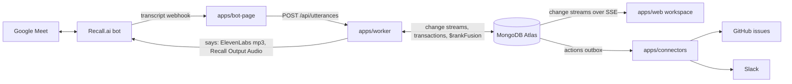

# Gomon: the design-call agent with governed team memory

Agents in Context Toronto (MongoDB), Nov 14, 2026. Track: **Statement Two, memory you can govern**, plus audited actions.
Team: Max (workspace, connectors), Tamir (Recall bot, voice), Rob (Atlas, agent worker). All company context is synthetic (`seed/`).

Gomon joins an engineering design call as a voice participant. It writes the call's decisions, requirements and risks to MongoDB
Atlas as they're said, checks them against the team's canonical memory, and speaks only when someone talks to it. The one
exception: an idea that would break a locked decision or customer requirement, which it raises once, at a pause. It locks
decisions by consensus with a veto window, then files GitHub issues and Slack posts through a policy-checked, audited outbox.
Full product spec: [`spec.md`](spec.md).



## How it answers Statement Two
| Question | Gomon |
|---|---|
| Keep one team's memory from leaking into another's | Every memory has `teamId`/`projectId`; every `$vectorSearch`/`$search` pre-filters on them (another team's fixture is seeded to prove it) |
| Fix or drop a wrong or expired memory | "Gomon, correct that" supersedes with a new version; "forget that" tombstones it. Both are transactions with audit rows and leave retrieval at once. Call scratch items expire by TTL unless locked |
| Prove memory changed behavior | The same proposal is flagged only with memory on, citing the stored decision; a correction changes the next answer; each reply records the memory ids it used |

## Atlas features used
Replica-set transactions (lock, correct, forget and their audit rows) · JSON-schema validators (a lock needs participants and
sources; a sent action needs a passing policy check) · TTL indexes (call scratch, sessions) · unique indexes (idempotent
utterances and actions) · change streams with stored resume tokens · **Automated Embedding** (`voyage-4`) + Atlas Search fused
with `$rankFusion` · per-user call visibility in `users`/`user_sessions`.

## Run it
Keys go in the repo-root `.env` (copy `.env.example`). Node 22+.
```bash
cd apps/worker && npm install && npm run setup && npm run seed   # Atlas collections, indexes, synthetic Northwind memory
VOICE_OUT=recall npm start                                       # agent worker on :3001, speaks through Recall
cd apps/bot-page && WORKER_URL= UTTERANCE_API_URL=http://localhost:3001/api/utterances npm start   # webhook relay on :8787
cd apps/web && npm install && npm run dev                        # workspace on :3000
cd apps/connectors && npm install && npm start                   # GitHub + Slack outbox
# expose :8787 publicly (any tunnel; webhooks only), then:
cd apps/worker && PUBLIC_BASE_URL=https://<tunnel> npm run join -- https://meet.google.com/<code> my-call "Design review"
```
Admit "Gomon" in Meet and open `http://localhost:3000/sessions/my-call`. Without a meeting: `npm run say -- my-call --script`
(in `apps/worker`) replays the demo conversation as typed utterances.

| App | Owner | Docs |
|---|---|---|
| `apps/worker` | Rob | [README](apps/worker/README.md): contracts, speech policy, templates, auth, verified runs |
| `apps/bot-page` | Tamir | [README](apps/bot-page/README.md): Recall bot, webhook, Output Media page, barge-in (PR #14) |
| `apps/web` | Max | [README](apps/web/README.md): live session, memory, workflows, database views |
| `apps/connectors` | Max | [README](apps/connectors/README.md): GitHub/Slack outbox, policy, idempotency |
