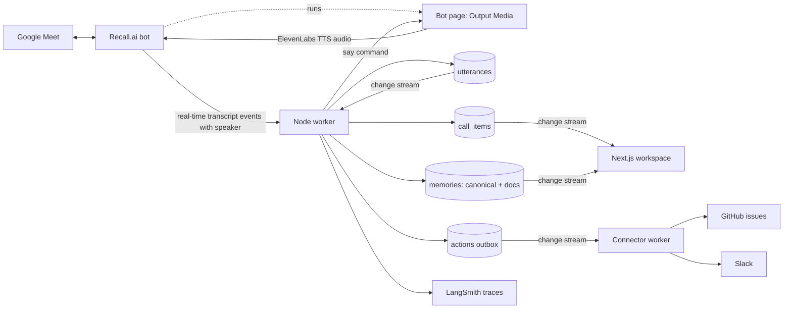

# Gomon — the design-call agent with governed team memory

Agents in Context Toronto (MongoDB hackathon), Nov 14, 2026. Submissions close **5:00 PM**. Team: Max, Tamir, Rob.
Track: **Statement Two — Memory you can govern**, with Statement One audit elements for every external action.
All company context in this repo is synthetic. The earlier aviation project is archived at tag `archive/aviation-v1`.

## 1. Problem

Engineering teams settle high-level design on calls: requirements, interfaces, tradeoffs, risks, owners. Low-level specs stay with each engineer. The call has the right people, but its outputs are rebuilt afterwards: someone rereads the transcript, writes the spec, files tickets, and posts updates. Conflicts with earlier decisions or customer requirements surface days later. Result: churn, repeat meetings, and slow design cycles.

## 2. Product

**Gomon** joins the call as a voice participant. It:

1. Listens and writes **call items** (proposed decisions, requirements, constraints, risks, open questions, actions, assumptions, interfaces, alternatives) to MongoDB Atlas in real time.
2. Checks every item against the team’s **canonical memory** (past decisions, customer requirements, ingested design docs) with Atlas hybrid search.
3. Speaks when addressed (“Gomon, …”) and selectively on its own: conflicts, re-debating a settled decision, consensus locks, and rare strong alternatives.
4. Detects consensus, announces “Locking in: …”, and promotes the item to canonical memory unless someone objects.
5. Turns locked decisions into GitHub issues and Slack posts, each tied to the person who triggered it, policy-checked, and audited.
6. Keeps memory governed: team-scoped, correctable, forgettable, with history, and provably changing what the agent does next time.

Not a notetaker: it participates during the call and the output is a governed, queryable design record, not a transcript.

## 3. How this answers Statement Two

| Statement question | Gomon’s answer |
|---|---|
| Keep one team’s memory from leaking into another’s | Every memory carries `teamId` and `projectId`; every query and vector search pre-filters on them; indexes declare them as filter fields |
| Fix or drop a wrong or expired memory | “Gomon, correct that” supersedes the memory with a new version; “Gomon, forget that” marks it forgotten (tombstone + audit). Both leave retrieval immediately; history stays queryable. Call scratch items expire by TTL unless promoted |
| Prove memory changed behavior | Same proposal with memory on vs. off: only with memory does Gomon flag the conflict and cite the stored decision. A correction changes the next answer. The workspace shows the retrieved memory IDs behind each response |

Statement One elements: every GitHub/Slack action records requester identity, the policy check result, and the outcome; nothing is sent without a passing policy check.

## 4. Demo

Scenario (synthetic company **Northwind API**): management report — *“Public API launches in 3 weeks. Finance wants per-tenant rate limits and metering. Acme is the launch customer.”*

Seeded memory (from `seed/`, ingested as if from the team’s GitHub design repo):
- **D-07** Single region `us-east-1`; Redis cluster already runs at the gateway.
- **D-09** No synchronous per-request writes to the billing database.
- **R-12** Acme needs bursts of 2,000 req/s for 60 s during nightly batch sync.
- **R-15** Usage must be billed per tenant, monthly, and be auditable.

Live script (also the basis of the 1-minute video):
1. Three engineers on a Google Meet. They invite Gomon; it joins as a participant.
2. Engineer: “Let’s just do a flat 100 requests per second per tenant.” The item appears in the workspace. **Gomon:** “That conflicts with R-12: Acme bursts to 2,000 per second for 60 seconds.”
3. Engineer: “We could log every request into the billing Postgres.” **Gomon:** “D-09 says no synchronous per-request billing writes. Earlier we chose async usage events.”
4. Team converges: token bucket in Redis at the gateway, tiered limits, enterprise burst 2,000/60 s, async usage events aggregated hourly. **Gomon:** “Locking in: tiered token-bucket limits with enterprise burst.” Nobody objects; the decision turns canonical in Atlas.
5. “Gomon, create the tickets.” GitHub issues appear with owners; a Slack post lands in the channel. The audit trail shows who asked and the policy check.
6. “Gomon, correct that — Acme’s burst is 3,000.” The memory is superseded; history shows both versions.
7. Fresh session: “Gomon, why do enterprise tenants get burst?” It answers from the corrected decision and cites it. Toggle memory off: the same flat-limit proposal no longer gets flagged.

## 5. Architecture



### Meeting join (Tamir)
- **Primary:** Recall.ai Create Bot with `meeting_url`, real-time transcription to our webhook/websocket, and `output_media.camera` = our bot page URL. The bot page plays Gomon’s speech (ElevenLabs TTS) into the meeting and shows a Gomon status card as the bot’s camera.
- Needs: Recall.ai account (none yet — sign up first thing; confirm trial access) and a public URL (ngrok) for the page and webhooks. Google Meet will ask the host to admit the bot.
- **Fallback if Recall is unavailable:** the same bot page runs in a browser on a laptop that is in the call. It captures audio from the mic, transcribes with ElevenLabs Scribe realtime, and plays ElevenLabs TTS. Speaker identity comes from a speaker picker on that page. Everything downstream is identical because the page posts the same utterance contract.

### Voice (Tamir)
- TTS: ElevenLabs streaming TTS (low-latency model), voice pinned in config.
- STT: Recall real-time transcripts in the primary path (speaker-labeled); ElevenLabs Scribe realtime in the fallback path.
- Only committed/final transcript segments become utterances. Partial text never triggers actions.
- One speech at a time; a new “Gomon” address cancels unspoken output. Barge-in is a stretch.

### Agent loop (Rob)
For each committed utterance (change stream on `utterances`):
1. **Extract** (fast LLM, structured output): zero or more call items with kind, text, and source utterance IDs. Batch at most ~2 utterances to bound latency.
2. **Check** each item with hybrid retrieval over `memories` (same team/project, `status: active`). Conflict or already-decided → create a `conflict` and, if severity is high, speak.
3. **Address** (“Gomon …” wake word in transcript text): reasoner with retrieved memories answers; response cites memory IDs.
4. **Consensus:** when recent turns show agreement on an item (explicit “let’s do that / agreed / sounds good” plus no open objection), Gomon announces “Locking in: X.” A 10-second veto window opens; “wait / no / hold on” cancels. Otherwise a transaction promotes the item to `memories`, writes the audit event, and records present participants.
5. **Commands:** “create the tickets”, “post to Slack”, “correct that …”, “forget that …” map to tools that write `actions` or memory updates, never directly to external systems.

Proactive speech budget: conflicts, already-decided, and lock announcements always; alternative suggestions at most once every 5 minutes.

### Workspace (Max)
Next.js page per call, updated live from Atlas change streams through server-sent events:
- **Transcript** (speaker + text), **Call items** (proposed/locking/promoted/rejected with veto countdown), **Canonical memory** (decisions, requirements; version history; forgotten shown greyed), **Conflicts**, **Architecture diagram** (Mermaid generated from active decisions), **Actions & audit** (GitHub/Slack status, requester, policy result), **Timings**.
- Humans can edit, lock, reject, correct, or forget from the UI; edits write to Atlas and go through the same rules as voice.
- Presence and live cursors are a stretch goal (simple websocket broadcast), not the source of truth.

## 6. MongoDB Atlas design (Rob)

Atlas is the state, memory, policy, and audit layer. Use the **Atlas Hackathon Sandbox** cluster (required for finalists).

| Collection | Holds | Atlas features |
|---|---|---|
| `teams`, `projects`, `members` | Identity: member ↔ meeting display name, role | Unique index on `(teamId, displayName)` |
| `policies` | Who may `lock_decision`, `create_issue`, `post_slack`, `forget_memory` | Read before every action |
| `calls` | Meeting URL, bot ID, status, participants | Change stream for workspace status |
| `utterances` | `callId`, `seq`, speaker, text, source, timestamps | Unique `(callId, sourceKey)` dedup; change stream wakes worker |
| `call_items` | Scratch items: kind, text, status, `sourceUtteranceIds`, `expiresAt` | TTL index on `expiresAt` (promoted items unset it); change stream |
| `memories` | Canonical memory **and** ingested doc chunks (`origin: call | doc`), kind, text, `teamId`, `projectId`, `status`, `version`, `supersedes`, `sourceRefs`, `lock`, embedding | Validator; Vector Search index + Atlas Search index on one collection so `$rankFusion` can fuse them |
| `conflicts` | Item ↔ memory, severity, spoken or not | Change stream |
| `actions` | Outbox: type, payload, `requestedBy`, `policyCheck`, status, `idempotencyKey`, `externalId` | Unique `idempotencyKey`; unique sparse `externalId`; validator; change stream for connector |
| `audit_events` | Every state change and action with actor and reason | Written in the same transaction as the change |
| `agent_events`, `timings` | What Gomon said/did, retrieved memory IDs, per-stage latency | Aggregations for the workspace panels |

Rules enforced by Atlas:
- `memories` validator: an `active` decision must have `lock.lockedAt` (date), `lock.participants` (non-empty), and `sourceRefs` (non-empty). Seeded docs use `origin: doc` with a source path.
- `actions` validator: status `sent` or `confirmed` requires `policyCheck.allowed: true` and `requestedBy`.
- Promotion, correction, and forget run in **transactions** with their audit events.
- Retrieval always pre-filters `teamId`, `projectId`, `status: "active"` — declared as `filter` fields in the vector index.

Retrieval:
- Embeddings: **Voyage** (we have a key) via the Embedding API, stored as vectors on `memories`. Switch to Atlas Automated Embedding only if the sandbox tier supports it (it is Preview).
- Hybrid: `$rankFusion` over `$vectorSearch` and `$search` on `memories` (requires MongoDB 8.0+; confirm cluster version). Requirement IDs like “R-12” need the lexical side.
- Vector index lags writes: the conflict check also reads recently promoted memories directly by query, not only through search.

Change streams: persist resume tokens in a `stream_offsets` collection; on worker restart resume from the token.

## 7. Integrations (Max)

All external effects go through the `actions` outbox: the agent writes an action, the connector worker checks policy, sends, and records `externalId`. Retries use the idempotency key and cannot create duplicates.

- **GitHub issues** (instead of Linear, no Linear access today): one issue per locked decision action, labels and assignee from the call. Uses a fine-grained token scoped to the demo repo.
- **Slack:** decision posts and a thread per call in the Hackathon 11/14 workspace (bot token or incoming webhook).
- **GitHub context ingest:** `seed/context/*.md` (synthetic design docs and requirements) chunked and embedded into `memories` with `origin: doc`.
- Roadmap only (say so in the pitch): Linear, Google Docs export, Miro/Lucid/Excalidraw sync, Zoom/Teams via the same Recall bot, calendar follow-ups.

## 8. Models, latency, and evals

- **LLM: decision needed now** — no sponsor LLM credits. One key (Anthropic or OpenAI) for a fast extraction model and a stronger reasoner, behind one adapter (`LLM_PROVIDER`).
- **Latency targets (unmeasured until we log them):** committed utterance → call item on screen ≤ 2 s; end of “Gomon” question → first audio ≤ 3 s. Record every stage in `timings` and show p50 in the workspace. If extraction is too slow, batch less, use a smaller model, or skip extraction for short filler utterances.
- **LangSmith:** trace extraction, retrieval, consensus, and reasoner calls with `callId` metadata. Evals are light today: keep one scripted demo call as a repeatable dataset (expected items, conflicts, locks). Expand after the hackathon.

## 9. Repo layout and contracts

```
apps/web        Next.js workspace + API routes (SSE from change streams)
apps/worker     Node: utterance consumer, agent loop, consensus timer, connector worker
apps/bot-page   Recall Output Media page (TTS playback, fallback mic + Scribe mode)
packages/shared Types and zod schemas shared by all three
seed/           Synthetic team, members, policies, memories, context docs
.env.example    MONGODB_URI, VOYAGE_API_KEY, ELEVENLABS_API_KEY, ELEVENLABS_VOICE_ID,
                RECALL_API_KEY, RECALL_REGION, LLM_PROVIDER, LLM_API_KEY,
                LANGSMITH_API_KEY, GITHUB_TOKEN, GITHUB_REPO, SLACK_BOT_TOKEN, SLACK_CHANNEL_ID,
                PUBLIC_BASE_URL
```

Agree these first (12:45), then split:
- **Utterance in:** `POST /api/utterances` `{ callId, sourceKey, speaker: { displayName }, text, startedAt, endedAt, source: "recall" | "scribe" }`
- **Say out:** worker → bot page over SSE `{ sayId, text, priority }`; page acks `started`/`done`.
- **Item/memory/action shapes:** in `packages/shared`.

## 10. Work split and timeline

| Owner | Scope |
|---|---|
| **Tamir** | Recall.ai bot join + real-time transcript → utterance API; bot page with ElevenLabs TTS; fallback Scribe mode |
| **Rob** | Atlas schema, validators, indexes, seed + Voyage embeddings, hybrid retrieval, agent loop, consensus, correct/forget, LangSmith |
| **Max** | Next.js workspace with live panels, Mermaid diagram, GitHub + Slack connectors via outbox, audit view |

| Time | Milestone |
|---|---|
| 12:45 | Contracts agreed; sandbox URI and keys in a shared `.env`; repo scaffolded |
| 2:15 | Typed utterances → call items → conflict flag → workspace (no voice) |
| 3:15 | Recall bot in Meet (or fallback) feeding utterances; Gomon speaks via ElevenLabs |
| 4:00 | Lock → GitHub issue + Slack; correct/forget; memory on/off proof |
| 4:15 | Feature freeze; record 1-minute video; rehearse live demo |
| 4:45 | **Make the repo public**, submit on Cerebral Valley with all members added |

## 11. Risks and fallbacks

| Risk | Fallback |
|---|---|
| Recall account or Meet admission fails | Laptop-in-call bot page with ElevenLabs Scribe; same pipeline |
| LLM latency too high | Smaller model for extraction; extract only on substantive utterances; precomputed seed embeddings |
| Gomon talks too much | Proactive budget; conflicts only above severity threshold |
| False consensus lock | 10 s veto window; undo in workspace; lock records participants |
| Search index lag hides a fresh decision | Direct query for recently promoted memories in the conflict check |
| Sandbox tier lacks a feature | Confirm version and index limits at 12:45; keep to two search indexes on `memories` |
| Repo still private at submission | Flip visibility at 4:45; required for judging |

## 12. Non-goals today

Production auth and multi-tenant hosting, Linear/Miro/Docs integrations, low-level spec writing, full eval suite, perfect diarization, barge-in.
