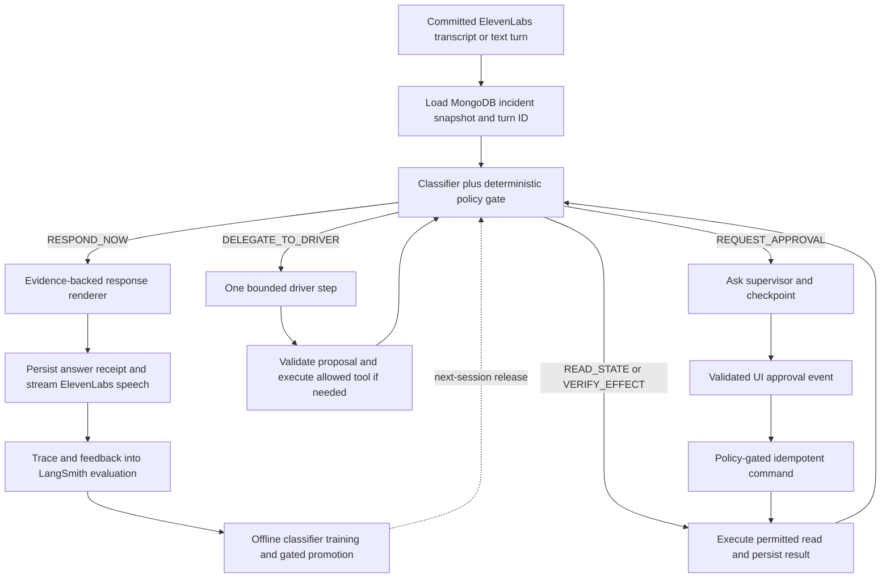

# MongoDbHackathon — Turn-Based Recovery Agent

Status: agreed architectural direction; design specification, not an implemented product.
Repository: https://github.com/WagerWarrior/MongoDB

## 1. The idea

A turn-based voice agent with a learned classifier in the loop, demonstrated through an aviation operations copilot answering:

**“The connection is back. Can I close this incident?”**

It detects a missed flight-status update, asks a supervisor to approve a refresh, and verifies what actually reached the airport display. A small decision model selects the next permitted step at every turn and tool-result boundary. When current evidence already supports an answer, it skips the larger driver model and responds through ElevenLabs immediately.

The core product is **an evaluated, learning decision layer that reduces unnecessary driver-model reasoning without sacrificing verified outcomes**. MongoDB stores state, decisions, feedback, and classifier releases; LangChain/LangGraph runs the loop; LangSmith traces and evaluates it; ElevenLabs provides speech input and output.

“LangShaft” is interpreted here as **LangSmith**, LangChain’s tracing and evaluation platform. LangSmith evaluates learning candidates; it does not automatically train or safely deploy our decision model. Speed and quality improvements are hypotheses until measured.

This is a standalone hackathon project, unrelated to other repositories or company infrastructure. All aviation data is fictional; this is not a flight-control or aviation-safety system.

## 2. What the Slack discussion settled on

Sources: Hackathon 11/14 [#agent-drop](https://app.slack.com/client/T0CHS0R8L10/C0CHU319A2V), Opheer’s 11:24 build-plan post; [#new-channel](https://app.slack.com/client/T0CHS0R8L10/C0CHLT9BM7F), the 11:20–11:25 discussion.

- Concrete scenario: airline feed says **Delayed · 10:20**, while the airport display still says **On time · 10:05**.
- Restore the connection without automatically replaying the missed update; the mismatch must remain visible.
- Read both records, explain the mismatch, request supervisor approval, refresh, then reread.
- Close only after a fresh observation confirms matching flight, status, and source version. An acknowledgment alone is insufficient.
- Persist observations, approval, refresh state, and verified outcome in MongoDB Atlas under one incident ID.
- In a fresh session for a different flight, use Vector Search to retrieve the resolved case; show the case ID and the actual check moved earlier.
- Add ElevenLabs voice and a clean side-by-side dashboard. Use LangChain and a fast, turn-based decision loop.
- Build one recovery first, cross-session memory second, worker-restart recovery third. Lean and a large agent swarm are stretch goals.

The broader enterprise-critical-events platform is the future direction, not the first build. The earlier shared “IMMUNITY” concept is background; aviation remains the concrete real-world-inspired scenario. The latest project direction makes the classifier/driver split, turn-based ElevenLabs voice, and evaluated classifier learning core requirements. No access to Jev or a particular proprietary decision model is assumed.

## 3. The smallest convincing demo

1. Open directly on two conflicting records for fictional flight HX101. Display source timestamps and versions prominently.
2. Supervisor asks by voice or text: “Can I close this incident?”
3. Show the classifier’s route and evidence receipt. After reading current records, it chooses `RESPOND_NOW` and answers: “Not yet. The airport display still shows On time from 10:05; the airline feed has Delayed from 10:20.” The approved factual response goes directly to ElevenLabs; no additional driver call is needed.
4. Supervisor clicks **Approve refresh** beside the evidence. The server records the approval before issuing the command.
5. Show **Refresh acknowledged — verification pending**. Keep the incident open until a new display read matches the current source.
6. Show the verification receipt and close the incident.
7. Start HX202 in a fresh session. Retrieve HX101’s resolved case and visibly compare the recorded investigation order with and without memory.
8. Compare the always-driver baseline, bootstrap router, and trained classifier on the same held-out scenarios. Show classifier release, actual driver calls avoided, correctness, and end-to-end voice latency. Publish the measured result even if the candidate is not faster.

Optional final beat, after the core demo works: terminate the worker after a refresh is sent, restart it, and show that it reloads the checkpoint and inspects the display before considering another send.

## 4. Minimal design and guardrails
### Turn-based classifier and driver loop

The driver is the larger tool-capable model used for unfamiliar or ambiguous requests. The classifier is a separate, small supervised decision model, not another open-ended reasoning agent.

| Decision | Meaning | Required constraint |
|---|---|---|
| `RESPOND_NOW` | End the reasoning loop and speak a supported answer | Current evidence passes the response validator; use a short approved template populated with observed facts |
| `READ_STATE` | Fetch missing or expired source/display evidence | Read tools only; classify again after persisting their results |
| `REQUEST_APPROVAL` | Explain the mismatch and pause for a supervisor | No write; approval is bound to the exact action and target version |
| `VERIFY_EFFECT` | Inspect the actual outcome of a sent command | ACK alone never becomes success |
| `DELEGATE_TO_DRIVER` | Handle an unfamiliar request or abstain from an uncertain fast route | One model step at a time; all proposals still pass policy gates |

Classifier features include the committed request’s intent/text features, incident state, evidence age, source/display agreement, approval validity, command uncertainty, previous tool result, and remaining turn budget. Only information available at that decision boundary is an input. Output: `route`, `classifierVersion`, calibrated route probability, `reasonCode`, and evidence IDs. Probability is calibrated on validation data, not an LLM’s self-reported confidence; use conservative per-route thresholds.

The policy gate can reject any route regardless of classifier confidence. Missing evidence must be read; ambiguous speech or unknown intent must be clarified or delegated; remembered facts cannot substitute for current state. A classifier never grants permission to write or close an incident. If an approved action is ready, deterministic execution handles it rather than asking the classifier to invent a command.

“Stop reasoning” means bypassing the next driver call or ending its tool loop at an explicit boundary. It does not mean inspecting or interrupting hidden reasoning within an in-flight provider request. LangChain supports pre-model short-circuiting; implement the policy explicitly in the graph and prevent an inner agent loop from bypassing the classifier. Set a bounded per-turn driver/tool budget; exhaustion produces an honest pending/clarification response, never fabricated completion.

Serialize work per incident, deduplicate transcript/approval events by ID, and pin a classifier release for the session. If the incident revision changes before rendering or action, reload and reclassify. The voice path consumes committed transcripts only; partial transcripts cannot trigger actions. Start with push-to-talk/manual turn commitment and one active response. A new turn invalidates obsolete unspoken output, but cancellation does not undo a command already sent.

### MongoDB-backed learning and LangSmith eval loop

Start with transparent bootstrap rules and an always-driver baseline to collect examples. Then train a small multinomial linear classifier on structured state plus fixed text features; keep feature extraction and calibration versioned with its weights. The learned release must actually be trained and exercised in the demo, not represented by a hard-coded route or a retrieved anecdote.

1. **Capture:** persist the boundary snapshot, chosen route, permitted alternatives, evidence IDs, driver/tool calls, outcome, latency, and human corrections in MongoDB. Join LangSmith runs with `incidentId`, `sessionId`, `turnId`, `decisionId`, and release versions.
2. **Label:** simulator state and reviewed examples determine valid routes and whether an early answer was supported. Driver suggestions are candidate labels, not ground truth; a successful incident does not prove every intermediate decision was correct. Keep provenance and adjudicate disagreements.
3. **Train:** a project-owned offline job reads approved examples, fits new classifier weights, and calibrates thresholds. Persist the immutable feature schema, coefficients, calibration, dataset revision, and artifact digest in a MongoDB classifier release record. Do not mutate live weights on every conversation.
4. **Evaluate:** export a sanitized, versioned dataset to LangSmith and compare always-driver, bootstrap, current release, and candidate. Split by incident and scenario family so related turns/paraphrases do not cross splits. Reserve a frozen held-out test set; tune thresholds on validation only, not test outcomes.
5. **Promote:** require zero false closure/unauthorized-effect failures on the safety suite and no correctness regression on held-out cases. Claim a latency improvement only when paired end-to-end measurements support it, including classifier overhead. Record counts and uncertainty; a passing finite suite is not a safety guarantee. Review the experiment before atomically changing the active release for new sessions.
6. **Monitor:** LangSmith traces and online evaluators flag unsupported answers, slow turns, and corrections for review. Roll back to the prior release on a critical regression. Use a new held-out set for future promotions rather than repeatedly tuning against a leaked test set.

Use collections for `incidents`, `observations`, `commands`, `turns`, `decisions`, `feedback`, `training_examples`, `classifier_releases`, and `resolved_cases`, plus the checkpointer’s own collections. MongoDB is the operational source of truth; LangSmith holds experiment datasets, traces, and evaluator feedback. Copy only approved/sanitized fields; never export credentials or raw audio by default.

This is self-learning through measured, versioned retraining, not unsupervised self-modification. Vector Search memory remains useful for retrieving analogous cases and proposing earlier checks; it is separate from training classifier weights.

### State and evidence

`Investigating → Awaiting approval → Refresh pending → Verifying → Resolved`

Unavailable, mismatched, or inconclusive evidence keeps the incident open with a reason. Rejected or expired approval prevents the write.

Each observation records `incidentId`, `flightId`, `status`, `sourceTime`, `sourceVersion`, and `observedAt`. Source time is not observation time: an old source value freshly read is still stale.

For a refresh-driven closure, obtain post-command reads of both systems. Require the same flight identity, status, source version, and associated source time. If the source advances during verification, recheck against the latest version rather than accepting the old command target. Close atomically against the evidence/version being verified; this proves consistency at that observation, not perpetual synchronization.

### Approval and restart safety

- Bind approval to the incident, flight, proposed action, and source version; record the supervisor identity. If the target changes, invalidate the approval and ask again.
- Use a stable command ID and receiver-side deduplication in the simulator. Record command intent before sending, acknowledgment separately, and verified application separately.
- On restart, load the checkpoint, inspect command status and fresh display state, and reuse the same command ID if a resend is justified. A missing acknowledgment does not prove the command failed.
- If a real receiver cannot deduplicate or expose completion, keep an ambiguous command open for review rather than claiming exactly-once behavior.
- Voice may request an investigation or explain evidence; it cannot bypass the server’s approval gate. Keep explicit approval in the UI for the first build.

### Implementation direction

- **UI:** React/TypeScript single-screen operations desk. Large source/display cards, evidence timeline, approval control, turn-based voice transcript, and decision receipt showing route, classifier release, driver calls, and measured latency.
- **Backend:** Python service plus LangGraph worker using LangChain tools. Explicit classifier, driver, observation, approval, command, verification, and response nodes. The classifier runs before every driver invocation and after each tool result; deterministic code owns permission and closure.
- **Atlas:** operational records, decision/training history, versioned classifier artifacts, LangGraph checkpoints, and resolved-case Vector Search. Start with one cluster and separate collections, not additional databases or queues.
- **LangSmith:** project-specific traces, curated datasets, experiments, deterministic outcome evaluators, reviewed feedback, and candidate-versus-baseline comparisons. Application code owns training and promotion.
- **Voice:** ElevenLabs speech-to-text for committed user turns and streaming text-to-speech for the backend-approved answer. Keep the decision loop in our service, not a second independent conversational agent. Use server-side credentials or scoped short-lived client authorization as supported by the selected speech API.
- **Models:** a small trained classifier controls whether an available low-latency tool-capable driver is needed. Choose the driver and embedding provider after checking team access; record exact versions in evaluations.

A stored memory contains the resolved case ID, failure pattern, useful check, evidence references, and verified outcome. Filter retrieval to resolved, compatible cases in this project. Memory is advice, not live truth or authorization. Wait for the new case to be searchable before presenting the cross-session demo; never substitute a hard-coded “retrieved” result.

LangGraph checkpoints alone do not make side effects exactly-once: resumed nodes may replay. [Official interrupt guidance](https://docs.langchain.com/oss/python/langgraph/interrupts) requires idempotent side effects. [Atlas Vector Search](https://www.mongodb.com/docs/atlas/atlas-vector-search/) provides retrieval, not a replacement for transactional operational reads.

Documentation basis: [LangChain custom middleware and pre-model short-circuiting](https://docs.langchain.com/oss/python/langchain/middleware/custom), [LangSmith evaluation concepts](https://docs.langchain.com/langsmith/evaluation-concepts), [ElevenLabs committed realtime transcripts](https://github.com/elevenlabs/elevenlabs-js/blob/main/_autodocs/api-reference/RealtimeConnection.md), and [streaming speech output](https://github.com/elevenlabs/elevenlabs-js/blob/main/_autodocs/api-reference/TextToSpeechClient.md).

## 5. Build order and acceptance

| Increment | Deliverable | Proof before expanding |
|---|---|---|
| 1. Turn-based recovery slice | Simulator, Atlas state, bootstrap classifier, bounded driver, approval, refresh, verification, response receipt | Every driver/tool boundary crosses the router; reconnect remains stale; unauthorized writes and ACK-only closure are rejected |
| 2. ElevenLabs voice | Committed speech turns and streamed approved answers | Correct answer names stale display/time; partial or duplicate transcripts do not execute actions; known supported answers skip the driver |
| 3. Evals and learned classifier | LangSmith baseline experiments, reviewed MongoDB examples, offline training, calibrated candidate, release promotion | A real trained artifact runs on held-out cases; compare routing correctness, safety, driver usage, and total latency; reject a failing candidate |
| 4. Cross-session memory | Resolved-case embedding and Atlas retrieval | Different flight retrieves the real case ID; paired traces show the useful check earlier without weakening any gate |
| 5. Restart | Durable checkpoint and deduplicated command handling | Terminate after send; restart reads display before resend; one applied command effect in the simulator |

Workstreams: simulator/policy gates; classifier/driver orchestration; Atlas/memory; ElevenLabs/dashboard; LangSmith datasets/training/evaluation. Agree boundary snapshots, route labels, and record/command contracts first, then split files. Team ownership is not assigned by this document.

## 6. Benchmarks and research worth using

Keep the initial implementation small. These are research/evaluation references, not a dependency list.

| Public benchmark | Why it fits | Limit |
|---|---|---|
| [τ-bench / τ² airline](https://github.com/sierra-research/tau2-bench), [paper](https://arxiv.org/abs/2506.07982) | Stateful tool use, user interaction, policy compliance, outcome-based evaluation | Airline customer service, not display recovery or aviation safety; pin release, task set, and simulator before comparisons |
| [LongMemEval](https://github.com/xiaowu0162/LongMemEval), [paper](https://arxiv.org/abs/2410.10813) | Cross-session retrieval, temporal reasoning, knowledge updates, abstention | Memory QA does not prove that the agent changed its investigation order |
| [τ-Voice](https://arxiv.org/abs/2603.13686) and the τ-bench voice harness | Grounded voice/tool tasks and turn-taking evaluation | Provider setup and benchmark versions affect comparability; voice quality alone does not establish correct recovery |

Research directions: τ²’s collaboration model informs the human/agent boundary; LongMemEval’s indexing/retrieval/reading split informs memory evaluation; [MemGPT](https://arxiv.org/abs/2310.08560) provides background on separating durable memory from the active context. Borrow the concepts, not an extra memory platform.

**Our local recovery benchmark:** stale display; restored connection without replay; ACK without application; wrong-flight display; source advancing during approval/verification; denied approval; unavailable reads; lost ACK; restart after send; irrelevant or outdated retrieved case. Derive expected results from simulator state and an effects ledger, not the model’s explanation.

Report false closures/all closures (and unsafe closures/all scenarios), unauthorized write attempts and applied writes separately, duplicate applied effects/restart trials, successful verified recoveries/eligible trials, retrieval recall@k, and paired change in useful-check position. Report zero denominators as N/A. Measure voice end-of-speech to first audible answer at p50/p95, plus factual agreement with the evidence. Pair memory/no-memory runs on the same scenarios, pin model/prompts/seeds where available, and keep a held-out set. No results have been run yet.

**Classifier-specific evals:** compare always-driver, bootstrap, and trained releases on identical scenario seeds and committed transcripts. Measure route confusion, supported-fast-response precision, abstention/driver-delegation rate, driver calls/tokens per turn, calibrated probability error, and task success. Separate unsafe early responses from ordinary intent errors. Include ambiguous speech, duplicate turns, outdated snapshots, unknown requests, and repeated approval attempts.

For responsiveness, timestamp speech end, committed transcript, classifier start/end, evidence/tool reads, driver requests, approved text, and first audible speech. Report classifier overhead and both transcript-to-approved-text and speech-end-to-audio p50/p95, with sample sizes and provider/model versions. Count “driver calls avoided” against the measured baseline, not a hypothetical unlimited reasoning loop. The demo must show observed improvement or honestly report no gain.

## 7. Reuse and the “wow” effect

- [langchain-mongodb](https://github.com/langchain-ai/langchain-mongodb) — MIT; reuse its MongoDB LangGraph checkpointer rather than inventing checkpoint storage. Our incident/approval/command schema remains application logic.
- [ElevenLabs JavaScript SDK](https://github.com/elevenlabs/elevenlabs-js) — reuse realtime speech-to-text commitment and streaming speech output while our graph owns turn and policy decisions.
- [LongMemEval](https://github.com/xiaowu0162/LongMemEval) and [τ-bench](https://github.com/sierra-research/tau2-bench) — public evaluation harnesses; adapt methodology first, run official suites separately if useful. Respect upstream data/provider requirements.
- [LangSmith](https://docs.langchain.com/langsmith/evaluation-concepts) — use its tracing and experiment comparison rather than inventing an evaluation dashboard; classifier training and release approval remain our application’s responsibility.

The [MongoDB NYC hackathon gallery](https://cerebralvalley.ai/e/mongodb-nyc-hackathon/hackathon/gallery.md) lists **Ripple first, Offload second, and Morgadarsha third**. Their published descriptions emphasize hidden checks, durable learning, and local outcome verification. Design takeaway: show a visible failure, the evidence-backed correction, and what improves next time. These are inspiration, not code to copy without license review.

Our demo differentiators: **the classifier knows when not to invoke the driver; trained releases earn promotion through evals; ACK is not recovery; memory changes an observed check order; restart does not blindly resend.** Prioritize the first three in the main demo and show receipts rather than animated claims.

The Slack-requested BowUI/“Anatomy Skill” references are not verified design dependencies. Do not block the first slice on them or claim an unavailable skill was used.

## 8. Decisions to settle next

1. Keep aviation recovery as the initial scenario; build toward a reusable turn-based decision layer rather than a broad platform first.
2. Choose team-accessible driver/embedding models and project-specific Atlas, LangSmith, and ElevenLabs accounts. Create the first labeled routing dataset and define per-route evidence requirements.
3. Agree workstream ownership and bounded turn budgets, then ship increment 1. Classifier learning and evaluation are core milestones, not optional showcase decoration.

Non-goals for this first build: live airline integration, autonomous operational changes, formal safety certification, a general enterprise platform, and a large multi-agent swarm.
