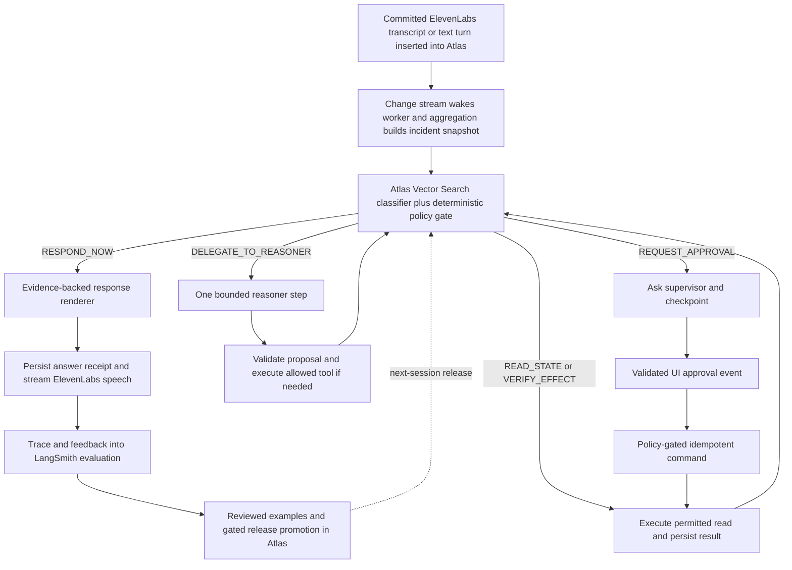

# MongoDbHackathon — MongoDB-Driven Recovery Agent

Status: proposed revision on branch `mongodb-drives`, not yet agreed by the team. It keeps the turn-based loop from `main` and makes MongoDB the component that drives it. Design specification, not an implemented product.
Repository: https://github.com/WagerWarrior/MongoDB

## 1. The idea

A turn-based voice agent that MongoDB Atlas drives, demonstrated through an aviation operations copilot answering:

**“The connection is back. Can I close this incident?”**

It detects a missed flight-status update, asks a supervisor to approve a refresh, and verifies what actually reached the airport display. Atlas selects the next permitted step at every turn and tool-result boundary by matching the current incident against reviewed past decisions. When current evidence already supports an answer, the agent skips the large reasoning model and responds through ElevenLabs immediately.

**The model can say it is fixed. Only MongoDB can close the incident.**

The core product is **a decision layer that lives in MongoDB: Atlas wakes the agent, chooses its next step from reviewed precedent, and accepts or rejects every state change**. The large model is a fallback for requests Atlas has no close precedent for. This document calls it the *reasoner*, so the word for what steers the loop is never attached to a model. LangGraph executes each step, LangSmith traces and evaluates, and ElevenLabs provides speech input and output. None of them decides whether an incident may change state.

“LangShaft” is interpreted here as **LangSmith**, LangChain’s tracing and evaluation platform. LangSmith evaluates learning candidates; it does not automatically build or safely deploy our classifier releases. Speed and quality improvements are hypotheses until measured.

This is a standalone hackathon project, unrelated to other repositories or company infrastructure. All aviation data is fictional; this is not a flight-control or aviation-safety system.

## 2. How MongoDB drives it

Each turn starts with a change in Atlas and ends with a write Atlas can refuse.

| Atlas does this | With this feature | Instead of |
|---|---|---|
| **Wakes the agent.** A committed transcript, an approval, a command acknowledgment, or a new airline-feed version is a document change. A worker watching change streams runs one bounded turn for that incident. | Change streams with a persisted resume token | An in-memory loop that forgets where it was on restart |
| **Picks the next step.** One aggregation builds the incident snapshot. Vector Search finds the nearest reviewed decisions, and they vote on the route. | Aggregation pipeline; Atlas Vector Search with a pre-filter | A separately trained and hosted decision model |
| **Rules on every write.** Approval, refresh, and closure are document updates that Atlas rejects unless the document itself carries the evidence. | Schema validator with `$expr`; conditional updates; a unique index; transactions | Guardrails that live only in a prompt or in application code |
| **Remembers.** Observations, decisions, feedback, classifier releases, resolved cases, and graph checkpoints. | Collections; Vector Search; the LangGraph MongoDB checkpointer | A separate memory platform |

### The incident document and the three rules

One document per incident moves through `investigating → awaiting_approval → refresh_pending → verifying → resolved`. It embeds the target (`flightId`, `status`, `sourceVersion`, `sourceTime`), the approval, the current command, and the verification, so Atlas can compare them within a single write.

1. **No refresh without an approval for the current version.** The document cannot be in `refresh_pending` or later unless its approval names a supervisor and the same `sourceVersion` as its target.
2. **No close without matching evidence read after the command.** The document cannot be `resolved` unless its verification matches the target’s flight, status, version, and source time, and was observed after the command was sent. An acknowledgment cannot satisfy this.
3. **No duplicate effect.** The simulated display records each applied command in an effects ledger with a unique index on `commandId`. A resend is a duplicate-key error, not a second write.

Rules 1 and 2 as a validator sketch. It is untested: no MongoDB instance has run it yet.

```js
db.createCollection("incidents", {
  validator: { $and: [
    // Every incident names its state and its target.
    { $jsonSchema: {
        required: ["state", "revision", "target"],
        properties: {
          state: { enum: ["investigating", "awaiting_approval",
                          "refresh_pending", "verifying", "resolved"] },
          target: { bsonType: "object",
                    required: ["flightId", "status", "sourceVersion", "sourceTime"] } } } },
    // Rule 1: no refresh without an approval for the current version.
    { $or: [
      { state: { $nin: ["refresh_pending", "verifying", "resolved"] } },
      { $expr: { $and: [
        { $eq: [{ $type: "$approval.supervisorId" }, "string"] },
        { $eq: ["$approval.sourceVersion", "$target.sourceVersion"] } ] } } ] },
    // Rule 2: no close without a matching read taken after the command.
    { $or: [
      { state: { $ne: "resolved" } },
      { $expr: { $and: [
        { $eq: [{ $type: "$command.sentAt" }, "date"] },
        { $eq: [{ $type: "$verification.observedAt" }, "date"] },
        { $gt: ["$verification.observedAt", "$command.sentAt"] },
        { $eq: ["$verification.flightId", "$target.flightId"] },
        { $eq: ["$verification.displayStatus", "$target.status"] },
        { $eq: ["$verification.displayVersion", "$target.sourceVersion"] },
        { $eq: ["$verification.displaySourceTime", "$target.sourceTime"] } ] } } ] }
  ] },
  validationAction: "error"
});
```

The required fields and `$type` checks are deliberate: inside `$expr`, two missing fields compare as equal, so a rule that only compares fields can be satisfied by leaving both out. The acceptance test for each rule is a write that Atlas rejects, including the missing-field cases.

**Compare-and-set, not last-write-wins.** Every state change is a conditional update naming the `state`, `revision`, and `target.sourceVersion` it expects. If the airline feed advanced or another worker already acted, the update matches nothing, and the agent reloads and reclassifies. When the feed advances, one update changes the target, clears the approval, and moves the state back to `awaiting_approval` together, because rule 1 rejects the document otherwise. Closure and its audit event commit in one transaction.

### Collections

| Collection | Holds | Relies on |
|---|---|---|
| `incidents` | State, revision, target, approval, current command, verification | Validator; conditional updates; change stream |
| `observations` | Every read of the feed or display, with `sourceTime`, `sourceVersion`, and `observedAt` kept separate | Append-only inserts |
| `commands` | Intent, acknowledgment, and verified application, recorded separately under a stable `commandId` | Unique index on `commandId` |
| `turns` | Committed transcripts and text turns | Unique index on `turnId`; change stream |
| `decisions`, `feedback` | Every route choice with its snapshot, voting examples, score, release, and latency; human corrections | Aggregation for the results panel |
| `decision_examples` | Reviewed, labeled decisions with an embedding, tagged by release | Vector Search index with filter fields |
| `classifier_releases` | Example-set revision, embedding model, neighbour count, thresholds, digest, active flag | Conditional update for promotion |
| `resolved_cases` | Verified, closed incidents with an embedding | Vector Search index |
| `audit_events` | Append-only record of each state change | Written in the same transaction as the change |
| `sim_feed`, `sim_display`, `sim_effects` | The labeled simulator: airline feed, airport display, and the display’s applied-effects ledger | Change stream on `sim_feed`; unique index on `sim_effects.commandId` |

The LangGraph checkpointer adds its own collections.

### What this does not prove

- Atlas checks the record, not the world. The validator rejects a closure whose recorded evidence does not match; it cannot tell whether that evidence came from a real read. Verification therefore stores the `observationId` it relied on, and the benchmark scores closures against simulator truth.
- A validator sees the document after the write, not the transition. It enforces invariants; ordering and concurrency come from the conditional updates.
- Vector Search is approximate and its index lags writes. It chooses routes and suggests checks; operational reads always come from the collections directly.
- The unique index gives one applied effect inside our simulator. It is not a claim of exactly-once delivery to a real receiver.
- Change-stream wake-up, the embedding call, and the vector query all add latency. None has been measured.

## 3. What the Slack discussion settled on

Sources: Hackathon 11/14 [#agent-drop](https://app.slack.com/client/T0CHS0R8L10/C0CHU319A2V), Opheer’s 11:24 build-plan post; [#new-channel](https://app.slack.com/client/T0CHS0R8L10/C0CHLT9BM7F), the 11:20–11:25 discussion.

- Concrete scenario: airline feed says **Delayed · 10:20**, while the airport display still says **On time · 10:05**.
- Restore the connection without automatically replaying the missed update; the mismatch must remain visible.
- Read both records, explain the mismatch, request supervisor approval, refresh, then reread.
- Close only after a fresh observation confirms matching flight, status, and source version. An acknowledgment alone is insufficient.
- Persist observations, approval, refresh state, and verified outcome in MongoDB Atlas under one incident ID.
- In a fresh session for a different flight, use Vector Search to retrieve the resolved case; show the case ID and the actual check moved earlier.
- Add ElevenLabs voice and a clean side-by-side dashboard. Use LangChain and a fast, turn-based decision loop.
- Build one recovery first, cross-session memory second, worker-restart recovery third. Lean and a large agent swarm are stretch goals.

The broader enterprise-critical-events platform is the future direction, not the first build. The earlier shared “IMMUNITY” concept is background; aviation remains the concrete real-world-inspired scenario. The latest project direction makes the classifier/reasoner split, turn-based ElevenLabs voice, and evaluated classifier learning core requirements. No access to Jev or a particular proprietary decision model is assumed.

## 4. The smallest convincing demo

1. Open directly on two conflicting records for fictional flight HX101. Display source timestamps and versions prominently.
2. Supervisor asks by voice or text: “Can I close this incident?”
3. Show the classifier’s route receipt: the Atlas snapshot, the reviewed decisions that voted (by ID), and the classifier release. After reading current records, it chooses `RESPOND_NOW` and answers: “Not yet. The airport display still shows On time from 10:05; the airline feed has Delayed from 10:20.” The approved factual response goes directly to ElevenLabs; no additional reasoner call is needed.
4. Supervisor clicks **Approve refresh** beside the evidence. The server records the approval before issuing the command.
5. Show **Refresh acknowledged — verification pending**. Then press the labeled demo control **Try to close now**: the server attempts to set `resolved` on the acknowledgment alone, Atlas rejects the write, and the dashboard shows the actual validation error. The incident stays open.
6. A fresh display read lands and matches the current source. The same write now succeeds; show the verification receipt and the closed incident.
7. Start HX202 in a fresh session. Retrieve HX101’s resolved case and visibly compare the recorded investigation order with and without memory.
8. Compare the always-reasoner baseline, bootstrap router, and Atlas classifier release on the same held-out scenarios. Show classifier release, actual reasoner calls avoided, correctness, and end-to-end voice latency. Publish the measured result even if the candidate is not faster.
9. Show one learned change: a request that delegated to the reasoner under the previous release is answered directly under the promoted one, and the receipt cites the reviewed example that made the difference.

Optional beats, after the core demo works:

- Advance the airline feed during verification with one simulator control. The conditional close matches nothing, the approval is cleared, and the agent asks again for the new version.
- Terminate the worker after a refresh is sent and restart it. It resumes the change stream, reloads the checkpoint, and inspects the display before considering another send.

## 5. Minimal design and guardrails
### Turn-based classifier and reasoner loop

The reasoner is the larger tool-capable model used for unfamiliar or ambiguous requests. The classifier is an Atlas query over reviewed decisions (a supervised nearest-neighbour vote), not another open-ended reasoning agent and not a separately hosted model.



| Decision | Meaning | Required constraint |
|---|---|---|
| `RESPOND_NOW` | End the reasoning loop and speak a supported answer | Current evidence passes the response validator; use a short approved template populated with observed facts |
| `READ_STATE` | Fetch missing or expired source/display evidence | Read tools only; classify again after persisting their results |
| `REQUEST_APPROVAL` | Explain the mismatch and pause for a supervisor | No write; approval is bound to the exact action and target version |
| `VERIFY_EFFECT` | Inspect the actual outcome of a sent command | ACK alone never becomes success |
| `DELEGATE_TO_REASONER` | Handle an unfamiliar request or abstain from an uncertain fast route | One model step at a time; all proposals still pass policy gates |

The decision is two Atlas reads followed by a gate.

1. **Snapshot.** One aggregation over the incident, its latest observations, and its command computes the exact facts: incident state, evidence age, source/display agreement, approval validity, command uncertainty, previous tool result, and remaining turn budget. These are computed, never learned. Only information available at that decision boundary is included.
2. **Precedent.** The committed request is embedded, and Vector Search retrieves the nearest examples from `decision_examples`, pre-filtered to the session’s pinned release and to examples recorded in a compatible snapshot. The neighbours vote on the route, weighted by similarity. If the best match is too distant or the vote is too close, the route is `DELEGATE_TO_REASONER`.
3. **Gate.** Deterministic policy checks the chosen route against the snapshot.

Output: `route`, `classifierRelease`, vote share, top similarity, `reasonCode`, the IDs of the examples that voted, and evidence IDs. Thresholds are calibrated per route on validation data and set conservatively; the score is never an LLM’s self-reported confidence.

The policy gate can reject any route regardless of classifier confidence. Missing evidence must be read; ambiguous speech or unknown intent must be clarified or delegated; remembered facts cannot substitute for current state. A classifier never grants permission to write or close an incident. If an approved action is ready, deterministic execution handles it rather than asking the classifier to invent a command.

“Stop reasoning” means bypassing the next reasoner call or ending its tool loop at an explicit boundary. It does not mean inspecting or interrupting hidden reasoning within an in-flight provider request. LangChain supports pre-model short-circuiting; implement the policy explicitly in the graph and prevent an inner agent loop from bypassing the classifier. Set a bounded per-turn reasoner/tool budget; exhaustion produces an honest pending/clarification response, never fabricated completion.

Serialize work per incident, deduplicate transcript/approval events by ID, and pin a classifier release for the session. If the incident revision changes before rendering or action, reload and reclassify. The voice path consumes committed transcripts only; partial transcripts cannot trigger actions. Start with push-to-talk/manual turn commitment and one active response. A new turn invalidates obsolete unspoken output, but cancellation does not undo a command already sent.

### MongoDB-backed learning and LangSmith eval loop

Start with transparent bootstrap rules and an always-reasoner baseline to collect examples. Then build the classifier inside Atlas: reviewed, labeled decisions are embedded and indexed for Vector Search, and a release pins the example set, embedding model, neighbour count, and calibrated thresholds together. The learned release must actually be built from reviewed examples and exercised in the demo, not represented by a hard-coded route or a single retrieved anecdote.

1. **Capture:** persist the boundary snapshot, chosen route, permitted alternatives, evidence IDs, reasoner/tool calls, outcome, latency, and human corrections in MongoDB. Join LangSmith runs with `incidentId`, `sessionId`, `turnId`, `decisionId`, and release versions.
2. **Label:** simulator state and reviewed examples determine valid routes and whether an early answer was supported. Reasoner suggestions are candidate labels, not ground truth; a successful incident does not prove every intermediate decision was correct. Keep provenance and adjudicate disagreements.
3. **Build:** a project-owned offline job reads approved examples, embeds them with the pinned embedding model, writes them to `decision_examples` under a candidate release ID, and calibrates the neighbour count and thresholds on the validation split. Persist the immutable snapshot schema, embedding model and version, thresholds, dataset revision, and a digest of the example IDs in a MongoDB classifier release record. A conversation never adds a voting example directly; new examples vote only after review and promotion.
4. **Evaluate:** export a sanitized, versioned dataset to LangSmith and compare always-reasoner, bootstrap, current release, and candidate. Split by incident and scenario family so related turns/paraphrases do not cross splits. Reserve a frozen held-out test set; tune thresholds on validation only, not test outcomes.
5. **Promote:** require zero false closure/unauthorized-effect failures on the safety suite and no correctness regression on held-out cases. Claim a latency improvement only when paired end-to-end measurements support it, including classifier overhead. Record counts and uncertainty; a passing finite suite is not a safety guarantee. Review the experiment before atomically changing the active release for new sessions.
6. **Monitor:** LangSmith traces and online evaluators flag unsupported answers, slow turns, and corrections for review. Roll back to the prior release on a critical regression. Use a new held-out set for future promotions rather than repeatedly tuning against a leaked test set.

The collections are listed in section 2, alongside the checkpointer’s own collections. MongoDB is the operational source of truth; LangSmith holds experiment datasets, traces, and evaluator feedback. Copy only approved/sanitized fields; never export credentials or raw audio by default.

This is self-learning through measured, versioned releases, not unsupervised self-modification. The classifier and the memory both use Vector Search but stay separate: `decision_examples` holds reviewed route labels and chooses the route; `resolved_cases` holds finished incidents and only proposes which check to run earlier.


### State and evidence

`Investigating → Awaiting approval → Refresh pending → Verifying → Resolved`

Unavailable, mismatched, or inconclusive evidence keeps the incident open with a reason. Rejected or expired approval prevents the write.

Each observation records `incidentId`, `flightId`, `status`, `sourceTime`, `sourceVersion`, and `observedAt`. Source time is not observation time: an old source value freshly read is still stale.

For a refresh-driven closure, obtain post-command reads of both systems. Require the same flight identity, status, source version, and associated source time. If the source advances during verification, recheck against the latest version rather than accepting the old command target. Close atomically against the evidence/version being verified; this proves consistency at that observation, not perpetual synchronization.

### Approval and restart safety

Each rule below is enforced in Atlas as described in section 2, and again in server code. The prompt and the browser enforce nothing.

- Bind approval to the incident, flight, proposed action, and source version; record the supervisor identity. If the target changes, invalidate the approval and ask again.
- Use a stable command ID and receiver-side deduplication in the simulator. Record command intent before sending, acknowledgment separately, and verified application separately.
- On restart, resume the change stream from its stored token, load the checkpoint, inspect command status and fresh display state, and reuse the same command ID if a resend is justified. A missing acknowledgment does not prove the command failed.
- If a real receiver cannot deduplicate or expose completion, keep an ambiguous command open for review rather than claiming exactly-once behavior.
- Voice may request an investigation or explain evidence; it cannot bypass the server’s approval gate. Keep explicit approval in the UI for the first build.

### Implementation direction

- **UI:** React/TypeScript single-screen operations desk. Large source/display cards, evidence timeline, approval control, turn-based voice transcript, and decision receipt showing route, classifier release, the examples that voted, reasoner calls, measured latency, and any write Atlas rejected.
- **Backend:** Python service plus a LangGraph worker that Atlas change streams wake, using LangChain tools. Explicit classifier, reasoner, observation, approval, command, verification, and response nodes. The classifier runs before every reasoner invocation and after each tool result. Within one wake-up the graph may run several steps, but it persists each boundary to Atlas before the next. Atlas rules and deterministic code own permission and closure.
- **Atlas:** the component that drives the loop and rules on its writes: change streams, the incident validator, conditional updates, the effects-ledger unique index, the snapshot aggregation, the Vector Search classifier and resolved-case memory, and LangGraph checkpoints. Start with one cluster and separate collections, not additional databases or queues. The dashboard and the results panel render from change streams and aggregations over these collections.
- **LangSmith:** project-specific traces, curated datasets, experiments, deterministic outcome evaluators, reviewed feedback, and candidate-versus-baseline comparisons. Application code owns building releases and promoting them.
- **Voice:** ElevenLabs speech-to-text for committed user turns and streaming text-to-speech for the backend-approved answer. Keep the decision loop in our service, not a second independent conversational agent. Use server-side credentials or scoped short-lived client authorization as supported by the selected speech API.
- **Models:** the Atlas classifier controls whether an available low-latency tool-capable reasoner is needed. The only model on the fast path is the embedding model, which both the classifier and the memory depend on. Choose the reasoner and embedding provider after checking team access; record exact versions in evaluations.

A stored memory contains the resolved case ID, failure pattern, useful check, evidence references, and verified outcome. Filter retrieval to resolved, compatible cases in this project. Memory is advice, not live truth or authorization. Wait for the new case to be searchable before presenting the cross-session demo; never substitute a hard-coded “retrieved” result.

LangGraph checkpoints alone do not make side effects exactly-once: resumed nodes may replay. [Official interrupt guidance](https://docs.langchain.com/oss/python/langgraph/interrupts) requires idempotent side effects. [Atlas Vector Search](https://www.mongodb.com/docs/atlas/atlas-vector-search/) provides retrieval, not a replacement for transactional operational reads.

Documentation basis: [LangChain custom middleware and pre-model short-circuiting](https://docs.langchain.com/oss/python/langchain/middleware/custom), [LangSmith evaluation concepts](https://docs.langchain.com/langsmith/evaluation-concepts), [ElevenLabs committed realtime transcripts](https://github.com/elevenlabs/elevenlabs-js/blob/main/_autodocs/api-reference/RealtimeConnection.md), and [streaming speech output](https://github.com/elevenlabs/elevenlabs-js/blob/main/_autodocs/api-reference/TextToSpeechClient.md).

## 6. Build order and acceptance

| Increment | Deliverable | Proof before expanding |
|---|---|---|
| 1. MongoDB-driven recovery slice | Simulator, Atlas collections with the incident validator and effects-ledger unique index, change-stream worker, bootstrap classifier, bounded reasoner, approval, refresh, verification, response receipt | Every reasoner/tool boundary crosses the router; reconnect remains stale; Atlas itself rejects an unapproved refresh, an ACK-only closure, and a duplicate command, and each rejection is captured by a test |
| 2. ElevenLabs voice | Committed speech turns and streamed approved answers | Correct answer names stale display/time; partial or duplicate transcripts do not execute actions; known supported answers skip the reasoner |
| 3. Evals and Atlas classifier | LangSmith baseline experiments, reviewed MongoDB examples, Vector Search index, calibrated candidate release, release promotion | A real release built from reviewed examples runs on held-out cases; compare routing correctness, safety, reasoner usage, and total latency including embedding and search time; reject a failing candidate |
| 4. Cross-session memory | Resolved-case embedding and Atlas retrieval | Different flight retrieves the real case ID; paired traces show the useful check earlier without weakening any gate |
| 5. Restart | Durable checkpoint and deduplicated command handling | Terminate after send; restart reads display before resend; one applied command effect in the simulator |

Workstreams: simulator/policy gates; Atlas schema, validator, and change streams; classifier/reasoner orchestration; memory; ElevenLabs/dashboard; LangSmith datasets/releases/evaluation. Agree the incident document, boundary snapshots, route labels, and record/command contracts first, then split files. Team ownership is not assigned by this document.

## 7. Benchmarks and research worth using

Keep the initial implementation small. These are research/evaluation references, not a dependency list.

| Public benchmark | Why it fits | Limit |
|---|---|---|
| [τ-bench / τ² airline](https://github.com/sierra-research/tau2-bench), [paper](https://arxiv.org/abs/2506.07982) | Stateful tool use, user interaction, policy compliance, outcome-based evaluation | Airline customer service, not display recovery or aviation safety; pin release, task set, and simulator before comparisons |
| [LongMemEval](https://github.com/xiaowu0162/LongMemEval), [paper](https://arxiv.org/abs/2410.10813) | Cross-session retrieval, temporal reasoning, knowledge updates, abstention | Memory QA does not prove that the agent changed its investigation order |
| [τ-Voice](https://arxiv.org/abs/2603.13686) and the τ-bench voice harness | Grounded voice/tool tasks and turn-taking evaluation | Provider setup and benchmark versions affect comparability; voice quality alone does not establish correct recovery |

Research directions: τ²’s collaboration model informs the human/agent boundary; LongMemEval’s indexing/retrieval/reading split informs memory evaluation; [MemGPT](https://arxiv.org/abs/2310.08560) provides background on separating durable memory from the active context. Borrow the concepts, not an extra memory platform.

**Our local recovery benchmark:** stale display; restored connection without replay; ACK without application; wrong-flight display; source advancing during approval/verification; denied approval; unavailable reads; lost ACK; restart after send; irrelevant or outdated retrieved case. Derive expected results from simulator state and an effects ledger, not the model’s explanation.

**Assert against the database.** Each local case also records what Atlas accepted and rejected: validation errors, duplicate-key errors, and conditional updates that matched nothing. A closure without matching recorded evidence should be rejected in every trial. False closures are still scored against simulator truth, because the validator cannot detect fabricated evidence. The results panel is an aggregation over the stored runs.

Report false closures/all closures (and unsafe closures/all scenarios), unauthorized write attempts and applied writes separately, duplicate applied effects/restart trials, successful verified recoveries/eligible trials, retrieval recall@k, and paired change in useful-check position. Report zero denominators as N/A. Measure voice end-of-speech to first audible answer at p50/p95, plus factual agreement with the evidence. Pair memory/no-memory runs on the same scenarios, pin model/prompts/seeds where available, and keep a held-out set. No results have been run yet.

**Classifier-specific evals:** compare always-reasoner, bootstrap, and Atlas classifier releases on identical scenario seeds and committed transcripts. Measure route confusion, supported-fast-response precision, abstention/reasoner-delegation rate, reasoner calls/tokens per turn, threshold calibration error, and task success. Separate unsafe early responses from ordinary intent errors. Include ambiguous speech, duplicate turns, outdated snapshots, unknown requests, and repeated approval attempts.

For responsiveness, timestamp speech end, committed transcript, change-stream wake-up, embedding and vector query, classifier start/end, evidence/tool reads, reasoner requests, approved text, and first audible speech. Report classifier overhead and both transcript-to-approved-text and speech-end-to-audio p50/p95, with sample sizes and provider/model versions. Count “reasoner calls avoided” against the measured baseline, not a hypothetical unlimited reasoning loop. The demo must show observed improvement or honestly report no gain.

## 8. Reuse and the “wow” effect

- [langchain-mongodb](https://github.com/langchain-ai/langchain-mongodb) — MIT; reuse its MongoDB LangGraph checkpointer rather than inventing checkpoint storage. Our incident/approval/command schema remains application logic.
- [ElevenLabs JavaScript SDK](https://github.com/elevenlabs/elevenlabs-js) — reuse realtime speech-to-text commitment and streaming speech output while our graph owns turn and policy decisions.
- [LongMemEval](https://github.com/xiaowu0162/LongMemEval) and [τ-bench](https://github.com/sierra-research/tau2-bench) — public evaluation harnesses; adapt methodology first, run official suites separately if useful. Respect upstream data/provider requirements.
- [LangSmith](https://docs.langchain.com/langsmith/evaluation-concepts) — use its tracing and experiment comparison rather than inventing an evaluation dashboard; building classifier releases and approving them remain our application’s responsibility.

The [MongoDB NYC hackathon gallery](https://cerebralvalley.ai/e/mongodb-nyc-hackathon/hackathon/gallery.md) lists **Ripple first, Offload second, and Morgadarsha third**. Their published descriptions emphasize hidden checks, durable learning, and local outcome verification. Design takeaway: show a visible failure, the evidence-backed correction, and what improves next time. These are inspiration, not code to copy without license review.

Our demo differentiators: **only MongoDB can close the incident; Atlas knows when not to invoke the reasoner; releases earn promotion through evals; ACK is not recovery; memory changes an observed check order; restart does not blindly resend.** Prioritize the first four in the main demo and show receipts rather than animated claims.

The Slack-requested BowUI/“Anatomy Skill” references are not verified design dependencies. Do not block the first slice on them or claim an unavailable skill was used.

## 9. Decisions to settle next

1. Keep aviation recovery as the initial scenario; build toward a reusable turn-based decision layer rather than a broad platform first.
2. Agree or reject this revision. Its two departures from `main` are that Atlas change streams wake the loop, and that the classifier is a Vector Search vote over reviewed decisions instead of a separately trained linear model.
3. Choose team-accessible reasoner/embedding models and project-specific Atlas, LangSmith, and ElevenLabs accounts. Confirm the chosen Atlas tier supports change streams, transactions, and Vector Search. Create the first labeled routing dataset and define per-route evidence requirements.
4. Agree workstream ownership and bounded turn budgets, then ship increment 1. Classifier learning and evaluation are core milestones, not optional showcase decoration.

Non-goals for this first build: live airline integration, autonomous operational changes, formal safety certification, a general enterprise platform, and a large multi-agent swarm.
